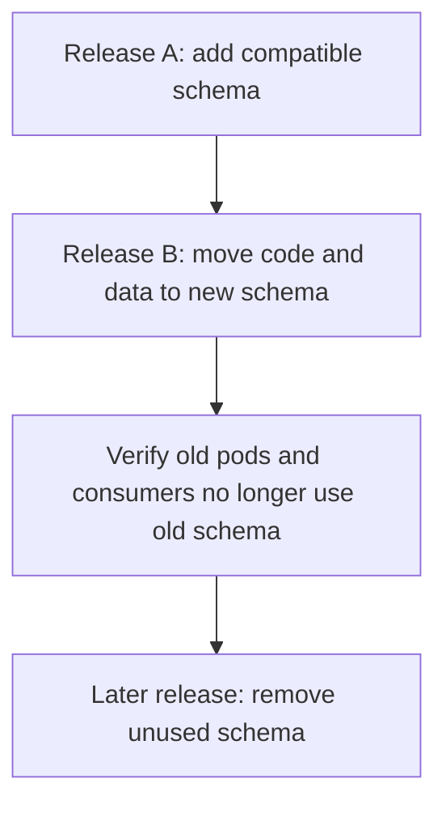

# Database migrations

Migrations use **Alembic** with the async template. `migrations/env.py` reads `DATABASE_URL` from
`app.config.Settings` and runs migrations through an async engine.

## Day-to-day commands

```bash
uv run poe up                              # Postgres must be running
uv run poe db-upgrade                      # uv run alembic upgrade head
uv run poe migration "add widgets table"    # autogenerate a new revision
```

`uv run poe migration` runs `alembic revision --autogenerate -m "..."`. **Always review the generated file.**
Autogenerate misses some changes, such as data migrations, renamed columns, and some server defaults.

## In Kubernetes

`deploy/k8s/base/migration-job.yaml` is a Job that runs `alembic upgrade head` with the same image and the
same Secret as the app. Argo CD runs it as a **PreSync hook**:

1. Ensure `app-config` and `app-secrets` already exist and the database is reachable.
   See [first-environment bootstrap](deployment.md#bootstrap-and-rotation-caveats).
2. Argo CD recreates the migration Job and waits for `alembic upgrade head` to succeed.
3. If the Job fails, the sync fails before the Deployment is updated.
4. On success, Argo CD applies the regular resources and rolls out the Deployment.

The overlays name the Job `app-migrate-dev` or `app-migrate-prod`.
`BeforeHookCreation` deletes the previous hook Job before each sync, so the name
does not need an image tag. Tracing is disabled for this short-lived Job.

## Expand, then contract



For example, add a replacement column before deploying code that uses it. Backfill
existing data and finish the transition before removing the old column in a later
release. Keep every migration compatible with the pods still serving traffic.

## Rules

- **Backward compatible.** Old and new pods overlap during a rollout, so each migration must work with the
  previous app version. Use expand, then contract: add the new column or table first, move the code, and
  drop the old column in a later release.
- **Never edit a released migration.** Add a new revision instead.
- **Downgrades are written but not run in production.** Keep them correct for local rollback.
- **Test migrations locally** against an empty database and against one with data before merging.
